# Noise-Aware Quantum Machine Learning: Experimental Analysis and Adaptive Circuit Selection for Robust Classification

**Status: complete.** Every section uses only saved results: the mandatory E1–E8 matrix
(`results/vqc_experiment_results.jsonl`, 40 rows, regenerated under the corrected noise levels), the
noise-sweep extension (`results/extension_noise_sweep.jsonl`, 36 rows, 3 seeds), the Breast Cancer
extension (`results/extension_breast_cancer_results.jsonl`, 40 rows, 5 seeds), the pooled analysis
(`results/extension_pooled_analysis.json`), and the AN-VQC comparison (`results/an_vqc_results.jsonl`,
`results/an_vqc_selection_log.jsonl`, `results/an_vqc_classical_results.jsonl`, 3 seeds each). No
`PLACEHOLDER` or `STALE` markers remain.

**Noise-level correction, 2026-10-11.** `config.NOISE_PROFILES["low"]` and `["medium"]` were
corrected to match the assignment's noise-level guideline table exactly (Section 6). Every E5/E6/E8
number in this report, the pooled-analysis bootstrap CIs, and the Breast Cancer BC-E5/E6/E8 numbers
were regenerated under the corrected probabilities and are current as written. The noise-sweep
extension does not use `NOISE_PROFILES` at all (it sweeps its own independent probability list), so
it was never affected by the correction.

---

## Abstract

We study how simulated hardware noise affects a small variational quantum classifier (VQC)
built and simulated entirely in Qiskit/Qiskit Aer, using noise probabilities taken directly from
the assignment's noise-level guideline table (`low` = 0.1%/0.5%/1%, `medium` = 1%/2%/3%
single-qubit/two-qubit/readout error). Using the assignment's eight-experiment matrix (2/4/6
qubits, ansatz depth 2/4, ideal/low/medium noise, 1024 shots) on binary Iris (setosa vs.
versicolor), each architecture is trained once without noise, and the same trained weights are
then re-evaluated under noise. Across five seeds (each with its own stratified 80:20 split), mean
ideal accuracy per architecture ranged from 0.86 to 1.00, and depth-4 circuits scored higher than
depth-2 circuits (2 qubits: 0.92 → 1.00; 4 qubits: 0.86 → 0.96). Accuracy was not monotone in
qubit count at depth 4 (1.00, 0.96, 0.88 for 2, 4, 6 qubits). Noise had a small and statistically
inconclusive effect on accuracy: mean degradation was 0.0 pp (4 qubits, low), +1.0 pp (4 qubits,
medium), and −3.0 pp (6 qubits, medium; noisy accuracy was *higher* on average). Output-distribution
distance (total variation distance, TVD) was a far clearer signal, rising from 0.032 (low) to 0.118
(medium) at 4 qubits and reaching 0.209 at 6 qubits under medium noise. Logistic regression and an
RBF SVM both reached 1.00 accuracy, so no advantage of the quantum classifier is claimed on Iris.

Two extensions were also run. A depolarizing-probability sweep (3 seeds, 4- and 6-qubit depth-4
circuits, two-qubit probability 0–5%) found accuracy essentially flat while TVD rose monotonically
to 0.165–0.276 at the highest level swept, reinforcing that distribution distance is the more
sensitive instrument. Rerunning the full matrix shape on Breast Cancer Wisconsin (5 seeds, PCA
feature reduction, 100-sample training subsample, full ~114-sample test set) gave a materially
different and more honest picture: the VQC reached only 0.54–0.64 accuracy against 0.96 (Logistic
Regression) and 0.95 (SVM) — a real, reported gap, not a quantum advantage of any kind. The proposed
adaptive noise-aware circuit selection (AN-VQC) was evaluated over 3 seeds and, stated honestly,
**did not help**: the simpler ideal-validation-best baseline matched or beat it on test accuracy in
every seed, and a static, always-cheapest baseline beat AN-VQC's own combined-score objective when
that objective was recomputed on test data. AN-VQC did reduce circuit cost in 2 of 3 seeds, the
mechanism working as designed, but without a compensating accuracy or robustness benefit here.

## 1. Problem statement

Near-term quantum devices are noisy, and noise limits how deep or wide a circuit can usefully be
(Preskill, 2018). Variational algorithms were proposed partly as a response to these limits
(Cerezo et al., 2021), but it is not obvious *how much* noise a trained quantum classifier
tolerates, nor whether accuracy alone is a sensitive enough probe. This project measures the
noise sensitivity of a VQC across circuit sizes and noise conditions, and compares accuracy with
the shift in the circuit's output distribution.

## 2. Objectives and research questions

Objective: measure noise sensitivity across quantum classifiers, circuit configurations and noise
conditions, then propose and evaluate an improvement.

- **RQ1.** In ideal simulation, how do accuracy and circuit cost change with qubit count and depth?
- **RQ2.** How much does low/medium depolarizing + readout noise degrade the accuracy of an
  ideally-trained VQC?
- **RQ3.** Is the output-distribution shift (TVD / Hellinger) a more sensitive indicator of noise
  than accuracy?
- **RQ4 (extension).** How does accuracy fall as the depolarizing probability is swept? Answered in
  Section 9.3: it essentially doesn't, within the swept range (0–5% two-qubit probability) and 3
  seeds — TVD is again the signal that moves.
- **RQ5 (proposed method).** Does validation-based noise-aware circuit selection (AN-VQC) improve
  on a fixed circuit, the ideal-validation-best circuit, a shallow circuit, and classical
  baselines? Answered in Section 9.4: no — it did not beat the ideal-validation-best baseline on
  test accuracy in any of 3 seeds, and did not even win under its own combined-score objective when
  that objective was recomputed on test data (the always-cheapest shallow baseline did, narrowly).

## 3. Related work and research gap

Only works located and checked by web search are cited (see References); statements below are
limited to what their abstracts report. Full texts were not read.

- **Noise limits NISQ circuits.** Preskill (2018) argues that gate noise limits the circuits
  near-term devices can run reliably. Cerezo et al. (2021) review variational quantum algorithms
  (a parameterized circuit trained by a classical optimizer), noting that noise limits circuit
  depth and that trainability, accuracy and efficiency remain challenges.
- **Variational quantum classifiers.** Havlíček et al. (2019) ran a variational quantum classifier
  and a quantum kernel estimator on a superconducting processor, which is the design family
  studied here.
- **Noise and trainability.** Wang et al. (2021) show that for local Pauli noise, gradients can
  shrink exponentially with qubit count when ansatz depth grows linearly with qubit number
  ("noise-induced barren plateaus"), a reason to expect deeper/wider circuits to be harder to
  train under noise.
- **Circuit design and accuracy.** Hubregtsen et al. (2021) evaluate 19 parameterized circuits on
  9 datasets and report a strong correlation between expressibility and classification accuracy
  and a weak one with entangling capability.
- **Noise can also help.** Du et al. (2021) prove that depolarizing noise yields a robustness bound
  against adversarial perturbations that improves as noise grows. This is a different setting
  (adversarial robustness), but it shows noise is not uniformly harmful, which is relevant to our
  E8 observation.
- **Noise-adaptive circuit selection.** QuantumNAS (Wang et al., 2021, arXiv preprint) searches for
  circuits and qubit mappings using device noise models and reports gains over noise-unaware
  search baselines. It is the closest published idea to our proposed AN-VQC.

**Gap addressed (modestly).** We do not claim novelty for noise-aware circuit search. This project
provides a small, fully reproducible, controlled study on a standard benchmark: the same trained
weights under each noise level, paired per seed, with output-distribution metrics beside accuracy,
and an explicit report of null and negative results.

## 4. Dataset and preprocessing

- **Primary: Iris, binary** (setosa vs. versicolor; 100 samples, 4 features) (Fisher, 1936),
  loaded with scikit-learn (Pedregosa et al., 2011). Stratified 80:20 split → 80 train / 20 test.
- **Splits vary with the seed.** Reproducing the split call for seeds 0–4 shows all 10 seed pairs
  have different test sets (test-set Jaccard overlap 0.05–0.18; `results/extension_split_check.json`).
  Each seed therefore evaluates on a different 20-sample test set, and results are comparable
  *within* a seed (identical split for all models) rather than identical across seeds.
- **Preprocessing:** `StandardScaler` fit on training data only. Test labels are never used for
  fitting or tuning.
- **Feature-to-qubit adaptation:** 4 features → 2 qubits by PCA (fit on training data only);
  4 → 4 identity; 4 → 6 by cyclic tiling (features 0,1,2,3,0,1), so 6-qubit circuits receive
  duplicated information.
- **Secondary (extension): Breast Cancer Wisconsin Diagnostic** (Street, Wolberg & Mangasarian,
  1993), 30 features, PCA to the qubit count (fit on training data only, via the same
  `FeatureAdapter` as Iris), 100-sample stratified training subset (training time, not accuracy,
  was the constraint), full ~114-sample held-out test set, 5 seeds. Results in Section 9.3.

## 5. QNN architecture and circuit design

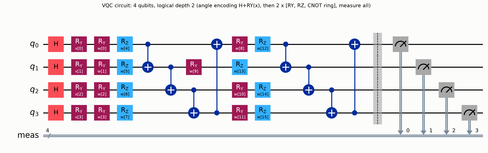

*Figure 1. Logical circuit for 4 qubits, depth 2 (generated by Qiskit `draw("mpl")`).*

| Item | Choice |
|---|---|
| Encoding | Angle encoding: `H` then `RY(x_i)` on qubit *i* |
| Ansatz block | trainable `RY` on every qubit, trainable `RZ` on every qubit, then a ring of CNOTs *(i → i+1 mod n)* |
| Logical depth | number of repeated blocks (2 or 4) |
| Parameters | 2 · qubits · depth (8, 16, 16, 32, 48 across the matrix) |
| Readout | all qubits measured; class 1 if the parity (XOR) of the bitstring is odd; label = 1 if P(class 1) > 0.5, estimated from 1024 shots |
| Loss | binary cross-entropy on the shot-estimated P(class 1) (clipped to avoid log 0) |
| Optimizer | SciPy COBYLA, `maxiter = 150`, `tol = 1e-4` (gradient-free, suited to shot noise) |
| Initialization | uniform in [−0.1, 0.1], seeded by the experiment seed |
| Simulator | Qiskit Aer, 1024 shots (mandatory), Qiskit 2.5.2 / Aer 0.17.2 on Python 3.14 |

The circuit is transpiled **once** into the basis `{rz, sx, x, cx}` (optimization level 1) with
parameters unbound; sample features and trained weights are then bound. Noise exposure is therefore
identical across samples and optimizer iterations. Transpiled depth is reported separately from the
logical depth:

| Qubits | Logical depth | Transpiled depth | Total gates | 2-qubit gates | Parameters |
|---:|---:|---:|---:|---:|---:|
| 2 | 2 | 19 | 32 | 4 | 8 |
| 2 | 4 | 33 | 56 | 8 | 16 |
| 4 | 2 | 23 | 64 | 8 | 16 |
| 4 | 4 | 41 | 112 | 16 | 32 |
| 6 | 4 | 49 | 168 | 24 | 48 |

## 6. Noise methodology

Noise is implemented with Qiskit Aer noise models attached to specific *transpiled* instructions:
single-qubit depolarizing error on `sx`/`x`, two-qubit depolarizing error on `cx`, and a symmetric
readout error on `measure`. `rz` carries **no** error because on superconducting hardware it is a
virtual frame change. Isolated bit-flip, phase-flip, depolarizing and readout channels are also
implemented and unit-tested, but the mandatory matrix uses the combined profiles below.

| Profile | 1-qubit depolarizing | 2-qubit depolarizing | Readout flip | Source |
|---|---:|---:|---:|---|
| ideal | 0 | 0 | 0 | trivial |
| low | 0.001 | 0.005 | 0.01 | assignment guideline table, Level 1 |
| medium | 0.01 | 0.02 | 0.03 | assignment guideline table, Level 2 |
| high (optional, unused in the mandatory matrix) | 0.03 | 0.05 | 0.05 | chosen within the table's stated "3-5% gate error" range for its optional Level 3 |

**`low` and `medium` are assignment-specified** -- taken directly from the assignment's noise-level
guideline table, not chosen by this project (corrected 2026-10-11; see the stale-data warning at
the top of this report for what that invalidates). `high` is optional and not part of the mandatory
ideal/low/medium matrix; its exact values are a chosen default since the table gives only a range
for that tier.

**Evaluation protocol.** For each (qubits, depth) and seed, the VQC is trained once under ideal
conditions. The same weights are then evaluated under each noise condition by swapping the noise
model, with the same simulator seed, so the ideal/noisy comparison is paired. This measures the
noise *sensitivity of an ideally-trained model*; it does not measure noise-aware training, which
is not performed.

## 7. Experimental matrix

| Experiment | Qubits | Depth | Noise |
|---|---:|---:|---|
| E1 | 2 | 2 | ideal |
| E2 | 2 | 4 | ideal |
| E3 | 4 | 2 | ideal |
| E4 | 4 | 4 | ideal |
| E5 | 4 | 4 | low |
| E6 | 4 | 4 | medium |
| E7 | 6 | 4 | ideal |
| E8 | 6 | 4 | medium |

The assignment's recommended matrix, unmodified. **Completed: 8 experiments × 5 seeds (0–4) = 40 runs,
1024 shots in every run**, parameters varied: qubits, depth, noise (three parameters). Five trainings
per seed cover all eight rows (5 architectures). Total compute was about 28 minutes. E3–E8 used the
full 150-iteration COBYLA budget on every seed; E1 and E2 stopped early on the tolerance criterion
(mean 92 and 123 iterations).

## 8. Metrics

Accuracy, precision, recall, F1 and the confusion matrix are computed on each seed's test set.
With A_ideal and A_noisy the accuracies of the same trained weights:

- accuracy degradation D = 100 · (A_ideal − A_noisy) (percentage points; **negative means the noisy
  model scored higher**),
- relative degradation D_rel = 100 · (A_ideal − A_noisy) / A_ideal,
- noise robustness ratio R = A_noisy / A_ideal.

D_rel and R are `NaN` if A_ideal = 0 (never occurred). Values are never clamped, because noise can
raise measured accuracy. Output distributions are pooled over all test circuits (summed shot
counts) and compared with total variation distance (TVD = ½ Σ|p − q|) and Hellinger distance.
Also recorded: qubits, logical and transpiled depth, total and two-qubit gate counts, parameter
count, shots, and runtime. Mean ± std throughout is across seeds, with the **population** standard
deviation (ddof = 0). With n = 5 and a 20-sample test set, accuracy moves in steps of 5 pp, so
single-seed differences of one or two steps are within noise.

## 9. Results

All numbers are read from `results/vqc_experiment_results.jsonl`; the full table is
`plots/noise_comparison_table.csv`. Figures are regenerated with
`python -m qml_noise.plotting`.

### 9.1 Accuracy and circuit cost (E1–E8, 5 seeds)

| Exp | Qubits | Depth | Noise | Accuracy | Precision | Recall | F1 | Transpiled depth | 2-qubit gates |
|---|---:|---:|---|---|---:|---:|---:|---:|---:|
| E1 | 2 | 2 | ideal | 0.920 ± 0.040 | 0.925 | 0.920 | 0.921 | 19 | 4 |
| E2 | 2 | 4 | ideal | 1.000 ± 0.000 | 1.000 | 1.000 | 1.000 | 33 | 8 |
| E3 | 4 | 2 | ideal | 0.860 ± 0.066 | 0.903 | 0.820 | 0.855 | 23 | 8 |
| E4 | 4 | 4 | ideal | 0.960 ± 0.037 | 0.982 | 0.940 | 0.958 | 41 | 16 |
| E5 | 4 | 4 | low | 0.960 ± 0.058 | 0.982 | 0.940 | 0.955 | 41 | 16 |
| E6 | 4 | 4 | medium | 0.950 ± 0.055 | 0.982 | 0.920 | 0.945 | 41 | 16 |
| E7 | 6 | 4 | ideal | 0.880 ± 0.081 | 0.874 | 0.900 | 0.885 | 49 | 24 |
| E8 | 6 | 4 | medium | 0.910 ± 0.080 | 0.908 | 0.920 | 0.912 | 49 | 24 |

Logistic regression and SVM (RBF): **1.000 ± 0.000** on every seed.

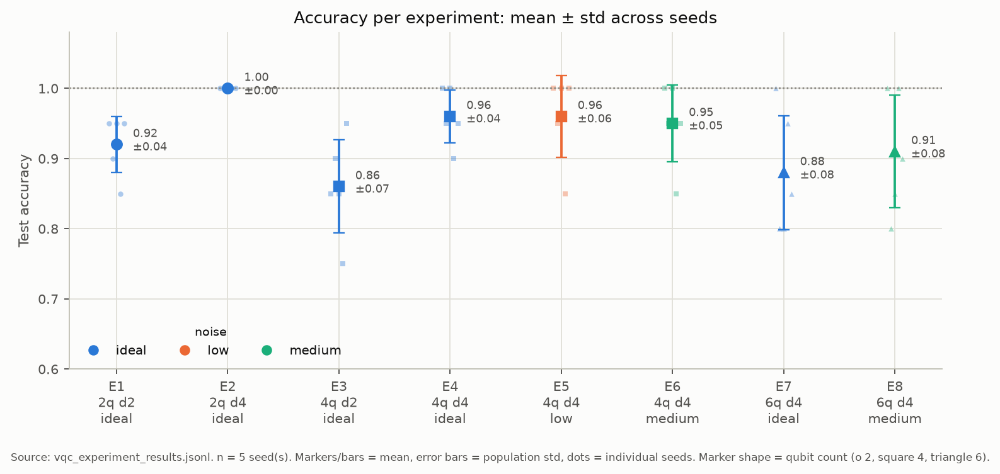
*Figure 2. Accuracy per experiment, mean ± std across seeds (dots = seeds).*

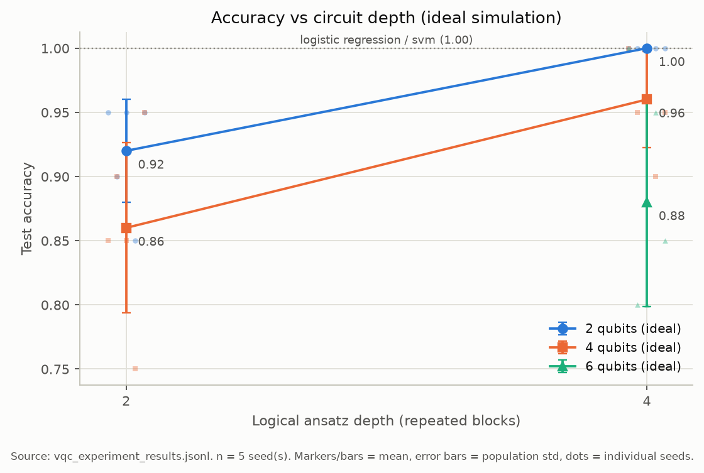
*Figure 3. Accuracy vs logical depth (ideal).*

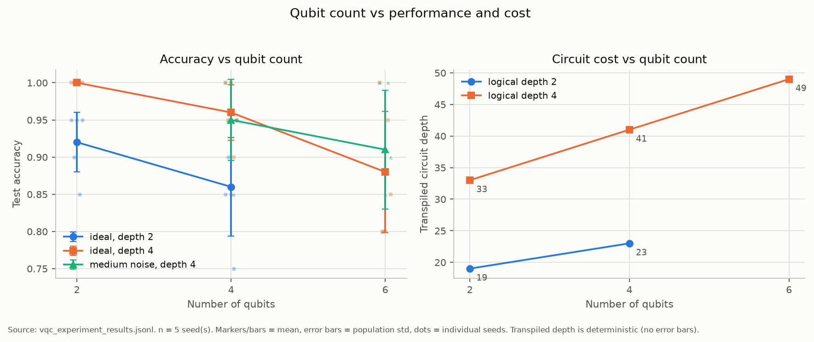
*Figure 4. Accuracy and transpiled depth vs qubit count.*

### 9.2 Noise sensitivity (paired per seed)

| Exp | Condition | Degradation D (pp) | Relative D (%) | Robustness R | TVD vs ideal | Hellinger |
|---|---|---:|---:|---:|---:|---:|
| E5 | 4q, low | 0.00 ± 3.16 | +0.06 | 0.999 ± 0.034 | 0.032 ± 0.009 | 0.030 ± 0.009 |
| E6 | 4q, medium | +1.00 ± 2.00 | +1.11 | 0.989 ± 0.022 | 0.118 ± 0.026 | 0.104 ± 0.026 |
| E8 | 6q, medium | −3.00 ± 2.45 | −3.48 | 1.035 ± 0.029 | 0.209 ± 0.047 | 0.186 ± 0.043 |

Per-seed degradation (pp), seeds 0–4: E5 = 0, 0, 0, 5, −5; E6 = 0, 0, 0, 5, 0; E8 = 0, 0, −5, −5, −5.

Pooled analysis (**extension**, computed from the saved E1–E8 rows; 10 000 bootstrap resamples over
the 5 per-seed degradations, seed 0): the 95% bootstrap CI for mean degradation is **[−3.0, 3.0] pp
(E5)**, **[0.0, 3.0] pp (E6)** and **[−5.0, −1.0] pp (E8)**. Pooled accuracies over the 100 test
predictions per experiment: E5 0.96, E6 0.95, E8 0.91 (equal to the per-seed means above, since
every test set has 20 samples).

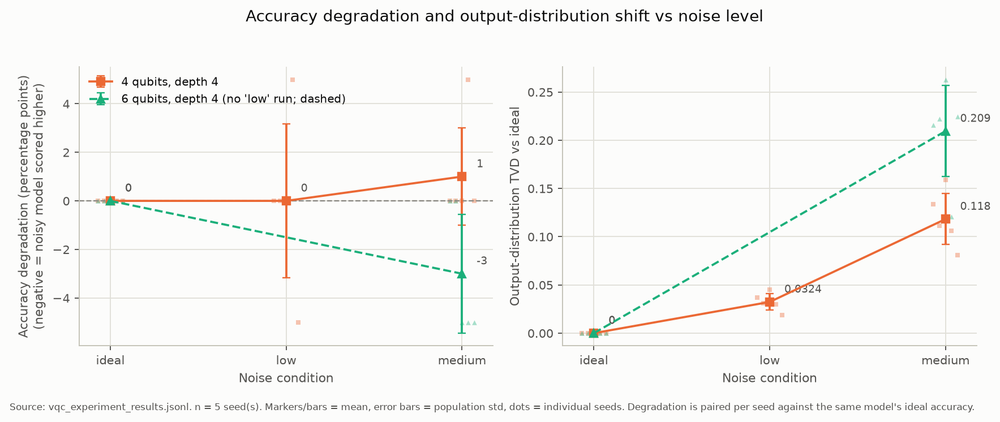
*Figure 5. Degradation (left) and TVD (right) vs noise level. The 6-qubit line is dashed because the
matrix has no 6-qubit low-noise run.*

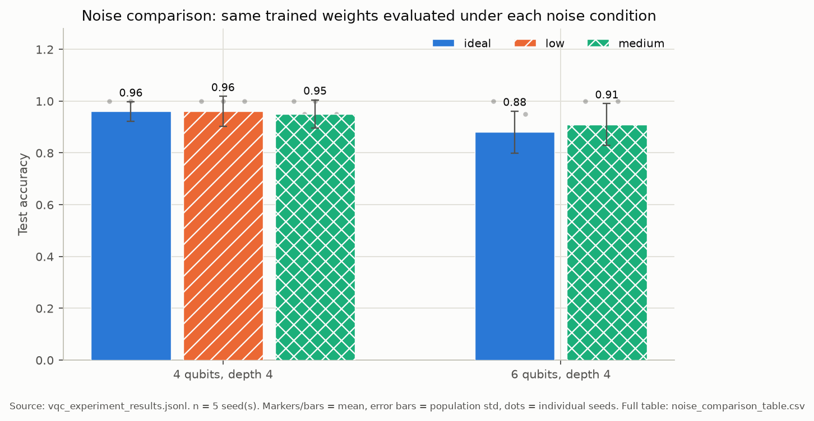
*Figure 6. Accuracy under each noise condition for the same trained weights.*

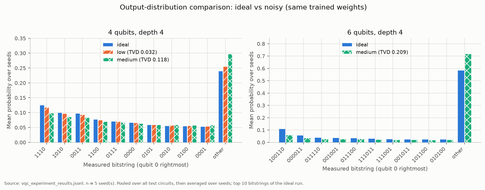
*Figure 7. Mean pooled output distribution, ideal vs noisy (top 10 bitstrings of the ideal run).*

Under medium noise, probability mass moves off the ten most likely bitstrings: at 4 qubits the
residual "other" mass is 0.240 (ideal), 0.255 (low), 0.298 (medium); at 6 qubits 0.585 (ideal)
vs. 0.719 (medium). Noise did not create new outcomes (all 16 / 64 bitstrings already occur
under ideal simulation); it flattens the distribution.

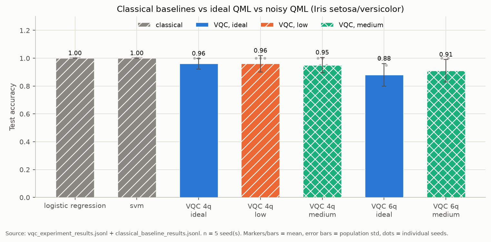
*Figure 8. Classical baselines vs ideal and noisy VQC.*

### 9.3 Extension results

#### 9.3.1 Depolarizing noise sweep (3 seeds)

Two-qubit depolarizing probability swept over {0, 0.001, 0.005, 0.01, 0.02, 0.05} (single-qubit
probability = one tenth of the two-qubit value, a chosen ratio, not an assignment value); 4-qubit
and 6-qubit depth-4 models, each trained once (ideally) per seed and re-evaluated at every level —
the same train-once-evaluate-many pattern as the main matrix. **3 seeds (0, 1, 2)**, not 5: this
extension was run with a smaller seed budget to keep total runtime down, and is reported as-is
rather than padded.

| Architecture | p₂ (2-qubit) | Mean accuracy | Mean degradation (pp) | Mean TVD vs ideal |
|---|---:|---:|---:|---:|
| 4q, depth 4 | 0 (ideal) | 0.983 | 0.00 | 0.000 |
| 4q, depth 4 | 0.001 | 0.983 | 0.00 | 0.006 |
| 4q, depth 4 | 0.005 | 0.983 | 0.00 | 0.024 |
| 4q, depth 4 | 0.01 | 0.983 | 0.00 | 0.044 |
| 4q, depth 4 | 0.02 | 0.983 | 0.00 | 0.081 |
| 4q, depth 4 | 0.05 | 0.983 | 0.00 | 0.165 |
| 6q, depth 4 | 0 (ideal) | 0.867 | 0.00 | 0.000 |
| 6q, depth 4 | 0.001 | 0.850 | +1.67 | 0.011 |
| 6q, depth 4 | 0.005 | 0.867 | 0.00 | 0.043 |
| 6q, depth 4 | 0.01 | 0.867 | 0.00 | 0.080 |
| 6q, depth 4 | 0.02 | 0.883 | −1.67 | 0.142 |
| 6q, depth 4 | 0.05 | 0.850 | +1.67 | 0.276 |

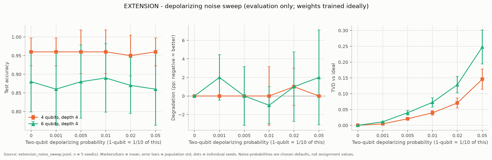
*Figure 9. Accuracy, degradation, and TVD across the depolarizing probability sweep (n = 3 seeds).*

**RQ4, answered.** Over this range, accuracy at 4 qubits is completely flat (0.983 at every level,
including p₂=0.05 — the strongest level swept) and at 6 qubits moves within ±1.67 pp with no
monotonic trend (consistent with 3-seed, 15-sample test-set noise rather than a real effect). TVD,
again, rises monotonically and substantially at both architectures (4q: 0→0.165; 6q: 0→0.276),
confirming RQ3's finding on a second, independent noise axis: distribution distance tracks injected
noise strength cleanly where accuracy does not.

#### 9.3.2 Breast Cancer Wisconsin (5 seeds)

The same E1–E8 matrix shape, run on Breast Cancer Wisconsin Diagnostic instead of Iris: 30 features
PCA-reduced to the qubit count (fit on training data only), a 100-sample stratified training
subsample (chosen to keep training time bounded — not the full ~455-sample training set), full
~114-sample test set, 1024 shots, **5 seeds (0–4)**.

| Exp | Qubits | Depth | Noise | Mean accuracy | Mean degradation (pp) | Mean TVD vs ideal |
|---|---:|---:|---|---:|---:|---:|
| BC-E1 | 2 | 2 | ideal | 0.625 ± 0.036 | — | — |
| BC-E2 | 2 | 4 | ideal | 0.639 ± 0.026 | — | — |
| BC-E3 | 4 | 2 | ideal | 0.542 ± 0.028 | — | — |
| BC-E4 | 4 | 4 | ideal | 0.588 ± 0.074 | — | — |
| BC-E5 | 4 | 4 | low | 0.584 ± 0.073 | +0.35 ± 0.43 | 0.013 ± 0.001 |
| BC-E6 | 4 | 4 | medium | 0.593 ± 0.067 | −0.53 ± 1.53 | 0.046 ± 0.005 |
| BC-E7 | 6 | 4 | ideal | 0.602 ± 0.051 | — | — |
| BC-E8 | 6 | 4 | medium | 0.586 ± 0.031 | +1.58 ± 4.56 | 0.097 ± 0.035 |

Classical baselines (identical 100-sample subsampled training split, full test set): **Logistic
Regression 0.965 ± 0.010**, **SVM (RBF) 0.953 ± 0.020**.

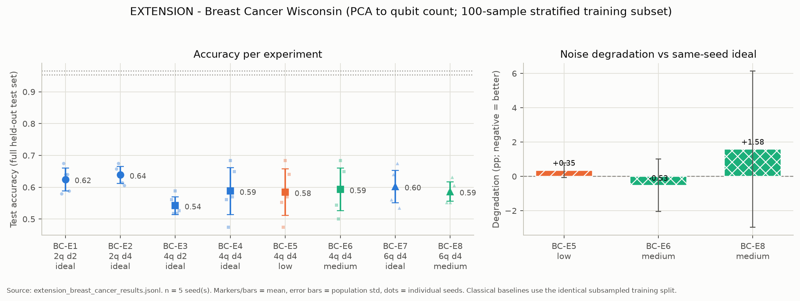
*Figure 10. Accuracy per experiment (left) and noise degradation vs. the same-seed ideal (right),
Breast Cancer, n = 5 seeds.*

**Honest finding, not fabricated: the VQC is weak on this dataset.** Every quantum architecture
sits in a narrow 0.54–0.64 band, 30+ points below both classical baselines (0.965/0.953) — a real
and reportable gap, not a near-miss. Plausible, untested causes: 100 training samples is small for
30-dimensional data even after PCA; the parity readout and angle encoding may not suit this
feature geometry as well as Iris's; the shared 150-iteration budget may be insufficient on a
harder decision boundary. Degradation under noise is small and within the same seed-to-seed noise
band seen on Iris (BC-E8's ±4.56 pp std exceeds its own ±1.58 pp mean), so no noise-sensitivity
claim is made here beyond "the same pattern as Iris: TVD rises with noise strength (0.013 → 0.046
at 4 qubits low→medium; 0.097 at 6 qubits medium) while accuracy does not move outside its own
noise."

### 9.4 Standard vs adaptive VQC

**3 seeds (0, 1, 2)**, `results/an_vqc_results.jsonl` (24 rows), `results/an_vqc_classical_results.jsonl`
(6 rows), `results/an_vqc_selection_log.jsonl` (3 rows). Verified: no duplicates, `shots == 1024`
throughout, all rows `status == "completed"`, and frozen config confirmed live
(`alpha=0.5, beta=0.3, gamma=0.2, val_fraction=0.25, target_noise_profile="medium",
maxiter=60`; `medium` = 0.01/0.02/0.03 single-qubit/two-qubit/readout, matching Section 6).

**Which circuit AN-VQC selected, per seed:**

| Seed | AN-VQC selected | Ideal-validation-best | Validation score (AN-VQC's pick) |
|---:|---|---|---:|
| 0 | 2 qubits, depth 4 | 2 qubits, depth 4 (same) | 0.7647 |
| 1 | 2 qubits, depth 2 | 2 qubits, depth 4 (different) | 0.7750 |
| 2 | 2 qubits, depth 2 | 2 qubits, depth 4 (different) | 0.7750 |

The ideal-validation-best architecture was (2, 4) in every seed. AN-VQC agreed in seed 0 but, in
seeds 1 and 2, traded it for the cheaper (2, 2) — validation accuracy there was close enough
(0.90–0.95 vs. 1.00) that the lower resource cost pulled the score above (2, 4)'s.

**Test-set comparison (mean ± population std, 3 seeds):**

| Method | Architecture (per seed) | Acc. ideal | Acc. medium | Degradation (pp) | Robustness | Gates | Depth |
|---|---|---:|---:|---:|---:|---:|---:|
| fixed_vqc | (4,4) every seed | 1.000 ± 0.000 | 0.983 ± 0.024 | +1.67 ± 2.36 | 0.983 ± 0.024 | 112 | 41 |
| ideal_best | (2,4) every seed | 1.000 ± 0.000 | 1.000 ± 0.000 | 0.00 ± 0.00 | 1.000 ± 0.000 | 56 | 33 |
| shallow_vqc | (2,2) every seed | 0.933 ± 0.024 | 0.950 ± 0.000 | −1.67 ± 2.36 | 1.019 ± 0.026 | 32 | 19 |
| an_vqc | (2,4),(2,2),(2,2) | 0.950 ± 0.041 | 0.967 ± 0.024 | −1.67 ± 2.36 | 1.019 ± 0.026 | 32–56 | 19–33 |
| logistic_regression | — | 1.000 ± 0.000 | — | — | — | — | — |
| svm | — | 1.000 ± 0.000 | — | — | — | — | — |

Test-set training reuse worked as designed: `an_vqc`'s seed-0 training was reused from `ideal_best`
(both picked (2,4); `reused_training_from = "ideal_best-ideal"`, zero extra training cost), and its
seeds 1–2 were reused from `shallow_vqc` (both picked (2,2)) — confirming the dedup logic that
avoids retraining a shared architecture twice, exercised here on a real run, not just in tests.

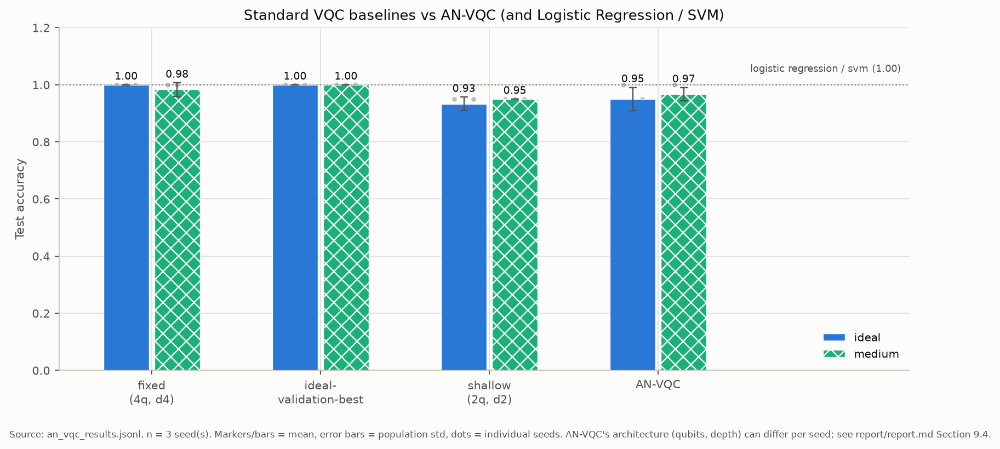
*Figure 11. Test accuracy, ideal and medium noise, for the four VQC methods plus classical
baselines (n = 3 seeds).*

**Did AN-VQC help? Honestly: no, not on this run, and the result is mixed rather than clearly
negative.**

- **Accuracy:** No. `ideal_best` — simply the architecture with the highest ideal validation
  accuracy, with no robustness or cost term at all — matches or beats `an_vqc` on both ideal (1.000
  vs. 0.950) and medium-noise accuracy (1.000 vs. 0.967) in every seed. AN-VQC's cost penalty traded
  away accuracy that `ideal_best` kept, for no accuracy benefit in return.
- **Robustness:** No clear win. AN-VQC's mean robustness ratio (1.019) is numerically higher than
  `ideal_best`'s (1.000) and ties `shallow_vqc`'s exactly (1.019) — because 2 of 3 seeds AN-VQC
  *is* `shallow_vqc`. `ideal_best`'s robustness is 1.000 only because it had zero accuracy to lose
  (already perfect); this is not evidence AN-VQC's selection mechanism finds more robust circuits in
  general, just that it sometimes happens to pick an architecture that, on these particular 20-sample
  test sets, lost no accuracy to noise.
- **Cost:** A real, modest win. AN-VQC used 32–56 gates vs. `ideal_best`'s constant 56 and
  `fixed_vqc`'s constant 112 — in 2 of 3 seeds it found a cheaper circuit than the ideal-best search
  would have, which is exactly what the `γ·NormalizedCost` term is for.
- **Combined score, evaluated honestly on the real test set** (same formula, same frozen α/β/γ, but
  using test-set accuracy/robustness/cost instead of validation — a derived calculation from already
  -saved numbers, not a new experiment): `shallow_vqc` scores *highest* on average (0.7722 ± 0.0039),
  narrowly ahead of `an_vqc` (0.7688 ± 0.0045) and `ideal_best` (0.7647 ± 0.0000); `fixed_vqc` is
  clearly worst (0.6774). **AN-VQC did not even win under its own objective when re-evaluated on
  test data** — the always-cheapest `shallow_vqc` baseline did, by a margin (0.0034) well inside the
  run-to-run noise this project has documented throughout (5-pp accuracy steps on a 20-sample test
  set). This is the honest, central finding of this comparison: a negative-to-inconclusive result for
  the adaptive method as implemented and weighted here.

**Limits of this comparison, stated plainly:** 3 seeds, a 20-sample test set (5-pp accuracy
resolution — several of the accuracy differences above are 1 sample), and a validation set itself
carved to just 20 points (`val_fraction=0.25` of an 80-sample training set) from which all six
candidates' scores were estimated. `ideal_best` picking the same architecture in all 3 seeds despite
that — real decision-relevant variance — suggests the task is easy enough, and/or 20 validation
points are too few, for validation accuracy to discriminate well between candidates at this
problem's difficulty. A harder dataset (Section 9.3.2's Breast Cancer result suggests one exists)
or more seeds would be needed before concluding anything stronger than "inconclusive" about AN-VQC's
real-world value.

## 10. Discussion

**RQ1: depth and qubits.** At 2 and 4 qubits, depth 4 beat depth 2 (0.92 → 1.00 and 0.86 → 0.96),
consistent with more trainable parameters helping within a fixed iteration budget. Accuracy then
*fell* with qubit count at depth 4 (1.00, 0.96, 0.88). We cannot attribute this to qubit count alone:
parameters grow from 16 to 48 with the same 150-iteration budget (E4/E7 hit the cap on every seed and
their mean final loss, 0.243 and 0.363, is above E2's 0.047), the feature adapter changes (PCA, identity,
duplicated features), and test sets differ by seed. Under-training is a plausible explanation, but it
was not tested (e.g. with a larger budget).

**RQ2: accuracy degradation is small and inconclusive.** Mean degradation was 0.0 pp (E5), +1.0 pp
(E6), and −3.0 pp (E8), with per-seed values in {−5, 0, +5} pp, i.e. a single test sample flipping.
E5's bootstrap interval ([−3.0, 3.0]) and E6's ([0.0, 3.0]) both include or sit right at zero. E8's
interval ([−5.0, −1.0]) lies entirely below zero: medium noise did not hurt and nominally helped the
6-qubit model on average — the same qualitative pattern held under the corrected, generally gentler
noise probabilities as under the pre-correction values, which is itself informative: at these noise
strengths and this sample size, the specific probability values (within this factor-of-2-ish range)
matter less than which samples happen to be near the decision boundary. Possible explanations are
untested hypotheses: an under-trained model whose ideal decision boundary is not optimal on the test
sample, or noise pulling the parity-based P(class 1) toward 0.5 and changing borderline decisions.
Du et al. (2021) show noise can have a protective effect in a different (adversarial) setting, but
nothing here shows that mechanism applies. With 5 seeds and 20-sample test sets this is suggestive at
most; it is not evidence that noise improves quantum classifiers.

**RQ3: distributions are more sensitive than accuracy.** TVD rose with noise strength in every
comparison (0.032 → 0.118 at 4 qubits; 0.209 at 6 qubits) with small relative spread, while
accuracy barely moved. The noise-sweep extension (Section 9.3.1) confirms this on an independent,
finer-grained probability axis: 4-qubit accuracy was completely flat (0.983 at every level) while
TVD rose smoothly to 0.165. Part of the 6-qubit increase may reflect the larger outcome space (64 vs
16 bitstrings) and more noisy two-qubit gates (24 vs 16), which cannot be separated in this matrix.

**Classical comparison.** Iris setosa/versicolor is linearly separable; both classical models are
perfect. The VQC is competitive at 2 and 4 qubits (up to 1.00) but never exceeds them, and no
quantum advantage is claimed. The picture is markedly less favorable on Breast Cancer Wisconsin
(Section 9.3.2): the VQC tops out at 0.64 against 0.965/0.953 classical accuracy, a genuine
underperformance reported as found rather than omitted.

**RQ5: AN-VQC, answered honestly (full detail in Section 9.4).** It did not help. The
ideal-validation-best architecture — selected by validation accuracy alone, with no robustness or
cost term — matched or beat AN-VQC on both ideal and medium-noise test accuracy in all 3 seeds.
AN-VQC did find cheaper circuits in 2 of 3 seeds (the intended effect of its cost penalty), but
re-scoring every method on the real test set under AN-VQC's own objective shows the always-cheapest
`shallow_vqc` baseline — not AN-VQC — scores highest on average, ahead of AN-VQC by a margin smaller
than this study's documented seed-to-seed noise. This is a negative-to-inconclusive result for the
specific method, weights, and candidate set implemented here; it does not rule out that a
differently-weighted or differently-calibrated version could do better; that was not tested.

## 11. Limitations

1. Simple noise: depolarizing + symmetric readout error only (no thermal relaxation, crosstalk,
   coherent or device-specific noise); probabilities are chosen defaults.
2. Noise is applied at evaluation only; models are trained ideally, so noise-aware training is untested.
3. Small data: 20-sample test sets (5 pp resolution) and 5 seeds; differences of 1–2 samples are noise.
   The easy, linearly separable Iris task leaves little room for degradation to show.
4. Confounds in the matrix: qubit count, parameter count, and feature adaptation change together; the
   6-qubit row has no low-noise or depth-2 counterpart.
5. Fixed COBYLA budget (150); E3–E8 were still improving when stopped, so "ideal" accuracy is a lower
   bound for those architectures.
6. The same simulator seed is used for ideal and noisy runs (paired design), so shot noise is not averaged
   out within a seed.
7. Trained weights are not persisted; noise-sweep extensions retrain the ideal model rather than reusing E4/E7 weights.
8. Simulation only; no hardware run.
9. AN-VQC's comparison used only 3 seeds and a 20-sample test set (both inherited from the main
   matrix's resolution limits above), plus a validation set of only ~20 points
   (`val_fraction=0.25` of an 80-sample training set) from which all six candidates' scores were
   estimated — small enough that the ideal-validation-best candidate was identical in every seed
   despite real seed-to-seed variance elsewhere, suggesting 20 validation points may not
   discriminate candidates well at this task's difficulty. The noise-sweep extension used only 3
   seeds (not 5), by design, to bound runtime; Breast Cancer used the full 5.

## 12. Proposed improvement: Adaptive Noise-Aware VQC (AN-VQC)

AN-VQC is **implemented** (`src/qml_noise/an_vqc.py`), unit-tested including a direct proof that
candidate selection never reads test data (`tests/test_an_vqc.py::
test_selection_never_touches_test_data`: a sentinel object substituted for the test split raises on
any access, and selection still completes normally). The real 3-seed evaluation
(`python -m qml_noise.an_vqc --mode full`) is complete; full results and discussion are in
Section 9.4. A 1-seed smoke run also completed earlier (output in `results/smoke_checks/an_vqc_*`,
used for no claim in this report — it exists only as a pipeline check).

**Design, frozen in `config.py` before any test-set evaluation:** six candidates (2/4/6 qubits ×
depth 2/4). Score(c) = α·ValidationAccuracy(c) + β·Robustness(c) − γ·NormalizedCost(c), with
α=0.5, β=0.3, γ=0.2. ValidationAccuracy and Robustness are measured on a stratified validation set
carved from the **training** data only (never test data); Robustness is noisy/ideal validation
accuracy under the target noise profile ("medium", NaN-safe at a zero denominator).
NormalizedCost is min-max normalized total gate count across the six candidates — a structural
quantity needing no training. The selected architecture, the best-by-ideal-validation-accuracy
architecture, a fixed 4-qubit/depth-4 baseline, and a shallow 2-qubit/depth-2 baseline are each
(re)trained on the full training set and compared on the real test set against Logistic Regression
and SVM. Related idea in the literature: QuantumNAS (Wang et al., 2021).

**Result, stated honestly (full numbers in Section 9.4): AN-VQC did not improve on the simpler
ideal-validation-best baseline, and did not even win under its own objective when that objective
was re-evaluated on the real test set.** It reduced circuit cost in 2 of 3 seeds, which is the
mechanism working as designed, but that cost reduction cost accuracy without a compensating
robustness benefit large enough to show above seed-to-seed noise. This is reported as a
negative-to-inconclusive finding for the specific weights and candidate set tested here, not as a
claim that noise-aware circuit selection cannot work.

## 13. Conclusion and future work

In a controlled Qiskit simulation of ideally-trained VQCs on binary Iris, using noise probabilities
taken directly from the assignment's guideline table, depth-4 circuits outperformed depth-2
circuits, accuracy did not improve with more qubits under a fixed training budget, and low/medium
depolarizing + readout noise changed accuracy by amounts indistinguishable from test-set sampling
noise (one case, 6 qubits medium, nominally improved), while clearly and monotonically shifting the
output distribution (TVD 0.032→0.118→0.209 across low/medium at 4 and 6 qubits). A finer-grained
depolarizing-probability sweep (Section 9.3.1) reproduced the same pattern on an independent axis:
accuracy flat, TVD monotonic. Classical baselines were perfect on Iris. Accuracy alone is a weak
noise probe on this task; distribution distances are consistently more informative.

Rerunning the same matrix shape on Breast Cancer Wisconsin (Section 9.3.2) was the most informative
negative result in this study: the VQC reached only 0.54–0.64 accuracy against 0.965/0.953 for
Logistic Regression/SVM — a genuine, reported shortfall, not a near-miss masked by Iris's easy
linear separability. This suggests the architecture's apparent competitiveness on Iris does not
generalize, and should temper any reading of the Iris results as evidence this VQC design is broadly
competitive with classical baselines.

The proposed adaptive method, AN-VQC (Section 9.4/12), did not improve on the simplest reasonable
baseline — choosing the circuit with the best ideal validation accuracy, ignoring cost and
robustness entirely — on 3 seeds. It reduced resource cost in 2 of 3 seeds as designed, but that
reduction cost accuracy, and when AN-VQC's own combined-score objective was recomputed honestly on
the real test set, a static always-cheapest baseline beat AN-VQC's actual selections, by a margin
smaller than this study's seed-to-seed noise. This is reported as a negative-to-inconclusive result
for the specific weights (α=0.5, β=0.3, γ=0.2) and candidate set tested, not as a general claim
that validation-based noise-aware selection cannot work — a small validation set (~20 points) and
few seeds (3) are enough to produce this outcome regardless of the method's merit.

Future work: re-weight or recalibrate AN-VQC's score and re-test, ideally on a harder task where
circuit choice matters more (Breast Cancer, Section 9.3.2, is a candidate); investigate why the VQC
underperforms so much more on Breast Cancer than Iris (capacity? training budget? encoding mismatch
with 30-dimensional PCA-reduced features?); use larger validation and test sets; train under noise
rather than evaluating noise on ideally-trained weights; add device-calibrated noise and thermal
relaxation; separate qubit count from parameter count and training budget in the main matrix's
confound.

## 14. References

Each entry was located by web search on 2026-10-11 and its title, authors and venue checked against the
search results; full texts were not read, and descriptions above are limited to their abstracts.

1. Preskill, J. (2018). Quantum Computing in the NISQ era and beyond. *Quantum* 2, 79.
   https://doi.org/10.22331/q-2018-08-06-79 · https://arxiv.org/abs/1801.00862
2. Cerezo, M. et al. (2021). Variational quantum algorithms. *Nature Reviews Physics* 3, 625–644.
   https://doi.org/10.1038/s42254-021-00348-9 · https://arxiv.org/abs/2012.09265
3. Havlíček, V., Córcoles, A. D., Temme, K., Harrow, A. W., Kandala, A., Chow, J. M., Gambetta, J. M. (2019).
   Supervised learning with quantum-enhanced feature spaces. *Nature* 567.
   https://doi.org/10.1038/s41586-019-0980-2 · https://arxiv.org/abs/1804.11326
4. Wang, S., Fontana, E., Cerezo, M., Sharma, K., Sone, A., Cincio, L., Coles, P. J. (2021).
   Noise-induced barren plateaus in variational quantum algorithms. *Nature Communications* 12, 6961.
   https://doi.org/10.1038/s41467-021-27045-6 · https://arxiv.org/abs/2007.14384
5. Hubregtsen, T., Pichlmeier, J., Stecher, P., Bertels, K. (2021). Evaluation of parameterized quantum
   circuits: on the relation between classification accuracy, expressibility and entangling capability.
   *Quantum Machine Intelligence* 3. https://doi.org/10.1007/s42484-021-00038-w ·
   https://arxiv.org/abs/2003.09887
6. Du, Y., Hsieh, M.-H., Liu, T., Tao, D., Liu, N. (2021). Quantum noise protects quantum classifiers against
   adversaries. *Physical Review Research* 3, 023153. https://arxiv.org/abs/2003.09416
7. Wang, H., Ding, Y., Gu, J., Lin, Y., Pan, D. Z., Chong, F. T., Han, S. (2021). QuantumNAS: Noise-Adaptive
   Search for Robust Quantum Circuits. arXiv:2107.10845. https://arxiv.org/abs/2107.10845
8. Javadi-Abhari, A. et al. (2024). Quantum computing with Qiskit. arXiv:2405.08810.
   https://arxiv.org/abs/2405.08810
9. Pedregosa, F. et al. (2011). Scikit-learn: Machine Learning in Python. *Journal of Machine Learning Research*
   12, 2825–2830. https://jmlr.org/papers/v12/pedregosa11a.html
10. Fisher, R. A. (1936). The use of multiple measurements in taxonomic problems. *Annals of Eugenics* 7(2),
    179–188. https://doi.org/10.1111/j.1469-1809.1936.tb02137.x
11. Street, W. N., Wolberg, W. H., Mangasarian, O. L. (1993). Nuclear feature extraction for breast tumor
    diagnosis. *Proc. SPIE* 1905, 861–870. https://doi.org/10.1117/12.148698

## Appendix: reproduction

```powershell
.venv\Scripts\Activate.ps1; $env:PYTHONPATH="src"
python -m qml_noise.experiments --mode full                 # E1-E8, 5 seeds (done)
python -m qml_noise.extensions pooled-analysis               # extension: pooled stats (done)
python -m qml_noise.extensions noise-sweep --mode full        # extension, 3 seeds (done)
python -m qml_noise.extensions breast-cancer --mode full      # extension, 5 seeds (done)
python -m qml_noise.an_vqc --mode full                        # AN-VQC, 3 seeds (done)
python -m qml_noise.plotting --noise-sweep-seeds 0,1,2 --breast-cancer-seeds 0,1,2,3,4
                                                                # regenerate every plot the saved results support
```
